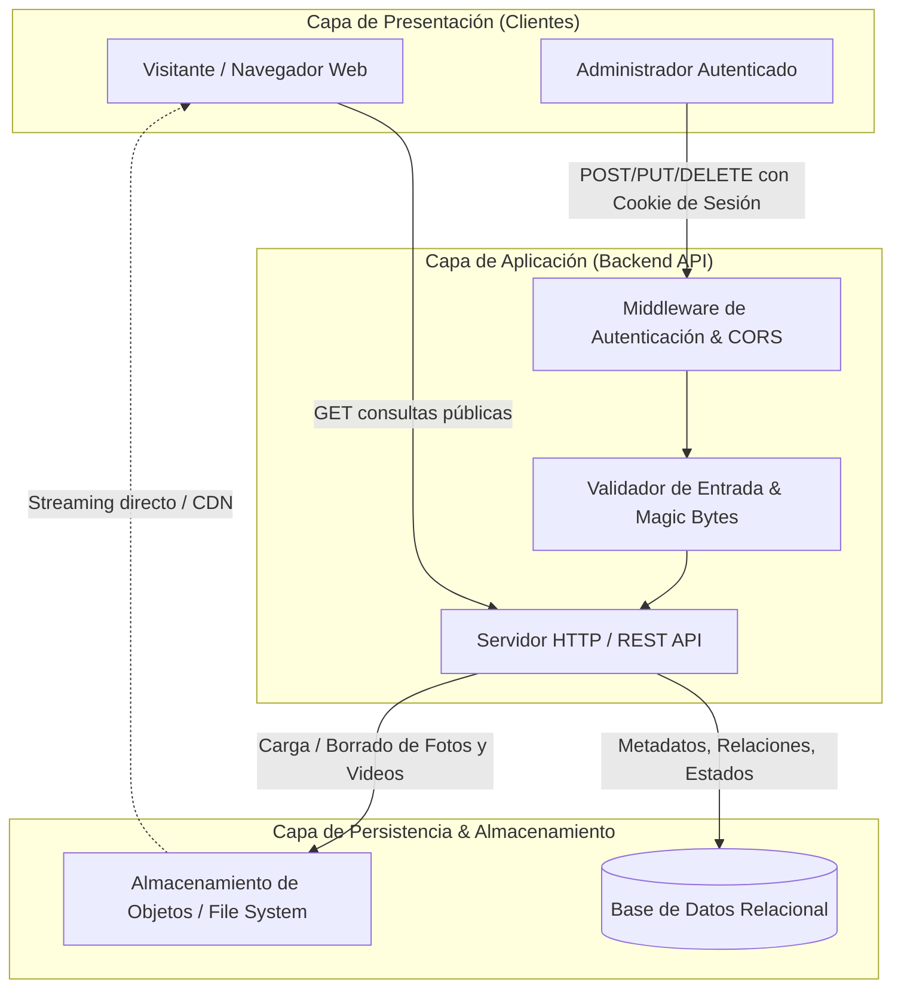
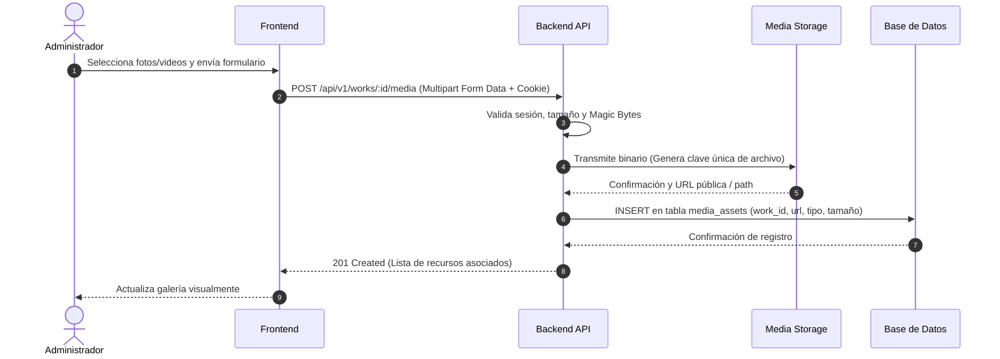
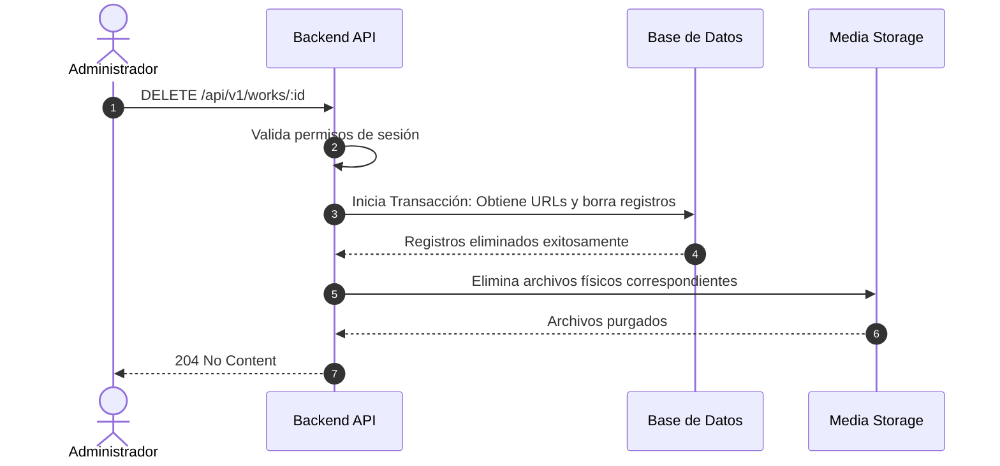

# Arquitectura del Sistema (System Architecture)

## 1. Visión General de la Arquitectura

El sistema sigue una arquitectura cliente-servidor desacoplada basada en servicios ligeros. Prioriza la simplicidad operativa, la baja latencia de entrega de activos y el mantenimiento mínimo, separando el consumo de datos de la persistencia de archivos binarios pesados.

## 2. Capas del Sistema

### 2.1. Capa de Presentación (Frontend)

- **Rol:** Renderizado de la interfaz minimalista, gestión de navegación y estados de la UI.
- **Responsabilidades:**
  - Consumo asíncrono de los endpoints REST de la API.
  - Gestión de vistas públicas (Feed cronológico, detalle de trabajo con visor multimedia).
  - Gestión de vistas protegidas (Panel administrativo, modales de confirmación de borrado, carga de archivos mediante _drag-and-drop_).
  - Optimización en cliente: compresión preliminar de imágenes opcional antes del envío, reproductores de video ligeros con carga bajo demanda (_lazy loading_).

### 2.2. Capa de Aplicación y Lógica de Negocio (Backend API)

- **Rol:** Procesamiento de solicitudes, validación de reglas de negocio y control de acceso.
- **Componentes principales:**
  - **Módulo de Autenticación:** Verificación de credenciales con hash criptográfico y emisión de cookies de sesión seguras (`HttpOnly`, `SameSite`, `Secure`).
  - **Módulo de Trabajos:** Validación de esquemas, transiciones de estado (_Por Realizar_, _En Curso_, _Terminado_) y gestión de fechas.
  - **Módulo de Multimedia:** Inspección de cabeceras MIME (_magic bytes_), aplicación de límites de tamaño y derivación de archivos al servicio de almacenamiento.

### 2.3. Capa de Datos (Base de Datos Relacional)

- **Rol:** Almacenamiento exclusivo de datos estructurados e índices de búsqueda.
- **Contenido:** Tablas de usuarios, trabajos y metadatos de recursos multimedia (URLs, tipos MIME, pesos en bytes, orden y llaves foráneas).

### 2.4. Capa de Almacenamiento de Archivos (Object Storage / Media Store)

- **Rol:** Persistencia física de binarios (fotografías y videos).
- **Estrategia:** La base de datos nunca almacena archivos binarios directos (BLOBs); únicamente almacena rutas o identificadores únicos gestionados por esta capa (almacenamiento local aislado o buckets tipo S3 / Cloudflare R2).

## 3. Flujo de Trabajo: Subida y Gestión de Archivos

Para evitar saturar la memoria del servidor durante la carga de videos, la subida se procesa mediante transmisión por flujo (_streaming_) hacia el almacenamiento:

Fragmento de código

## 4. Estrategia de Borrado en Cascada Físico

Cuando se elimina un trabajo o un recurso específico, la aplicación garantiza que no queden archivos huérfanos:

## 5. Decisiones Técnicas y Directrices de Despliegue

<table style="min-width: 75px;">
<colgroup><col style="min-width: 25px;"><col style="min-width: 25px;"><col style="min-width: 25px;"></colgroup><tbody><tr><td colspan="1" rowspan="1">
<strong>Componente</strong>
</td><td colspan="1" rowspan="1">
<strong>Opción Recomendada</strong>
</td><td colspan="1" rowspan="1">
<strong>Justificación</strong>
</td></tr><tr><td colspan="1" rowspan="1">
<strong>Arquitectura de API</strong>
</td><td colspan="1" rowspan="1">
Monolito modular REST
</td><td colspan="1" rowspan="1">
Elimina la sobrecarga de microservicios para un proyecto de alcance acotado.
</td></tr><tr><td colspan="1" rowspan="1">
<strong>Motor de Base de Datos</strong>
</td><td colspan="1" rowspan="1">
PostgreSQL o SQLite
</td><td colspan="1" rowspan="1">
ACID completo, integridad referencial estricta y bajo consumo de memoria.
</td></tr><tr><td colspan="1" rowspan="1">
<strong>Almacenamiento de Medios</strong>
</td><td colspan="1" rowspan="1">
Local Disk / S3 API
</td><td colspan="1" rowspan="1">
Abstracción por adaptador para migrar entre disco local y buckets sin cambiar código.
</td></tr><tr><td colspan="1" rowspan="1">
<strong>Sesiones</strong>
</td><td colspan="1" rowspan="1">
Cookies HttpOnly firmadas
</td><td colspan="1" rowspan="1">
Máxima mitigación frente a ataques XSS sin complejidad de refresco de tokens JWT.
</td></tr></tbody>
</table>
