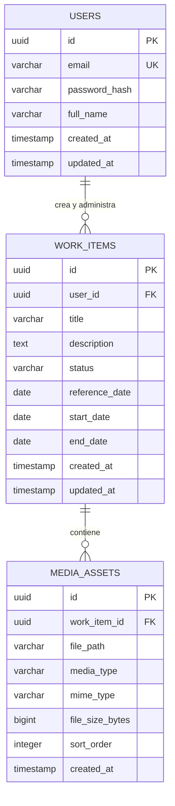

# Modelo de Datos (Data Model)

## 1. Enfoque del Modelo

El modelo de datos se basa en un esquema relacional normalizado en Tercera Forma Normal (3FN), diseñado para garantizar integridad referencial estricta, consultas cronológicas de baja latencia y borrado en cascada consistente.

La base de datos almacena exclusivamente datos estructurados y metadatos de los archivos; los binarios de fotos y videos se gestionan en el sistema de almacenamiento físico o de objetos y se referencian mediante rutas URI relativas o absolutas.

---

## 2. Diagrama Entidad-Relación (ERD)



---

## 3. Diccionario de Datos

### 3.1. Tabla: `users`

Almacena los usuarios autorizados con permisos administrativos para gestionar los trabajos y recursos multimedia.

| Columna         | Tipo de Dato               | Nulo | Por Defecto         | Descripción                                       |
| --------------- | -------------------------- | ---- | ------------------- | ------------------------------------------------- |
| `id`            | `UUID`                     | No   | `gen_random_uuid()` | Identificador único del usuario (Clave Primaria). |
| `email`         | `VARCHAR(255)`             | No   | —                   | Correo electrónico único para inicio de sesión.   |
| `password_hash` | `VARCHAR(255)`             | No   | —                   | Hash de la contraseña (bcrypt o Argon2id).        |
| `full_name`     | `VARCHAR(100)`             | No   | —                   | Nombre visible del administrador.                 |
| `created_at`    | `TIMESTAMP WITH TIME ZONE` | No   | `CURRENT_TIMESTAMP` | Fecha y hora de creación de la cuenta.            |
| `updated_at`    | `TIMESTAMP WITH TIME ZONE` | No   | `CURRENT_TIMESTAMP` | Fecha y hora de la última modificación.           |

---

### 3.2. Tabla: `work_items`

Entidad principal que almacena el registro y ciclo de vida de cada trabajo documentado.

| Columna          | Tipo de Dato               | Nulo | Por Defecto         | Descripción                                                 |
| ---------------- | -------------------------- | ---- | ------------------- | ----------------------------------------------------------- |
| `id`             | `UUID`                     | No   | `gen_random_uuid()` | Identificador único del trabajo (Clave Primaria).           |
| `user_id`        | `UUID`                     | No   | —                   | Llave foránea que referencia al autor en `users(id)`.       |
| `title`          | `VARCHAR(150)`             | No   | —                   | Título descriptivo del trabajo.                             |
| `description`    | `TEXT`                     | Sí   | `NULL`              | Notas detalladas, requerimientos o resumen del proceso.     |
| `status`         | `VARCHAR(20)`              | No   | `'pending'`         | Estado del trabajo (`pending`, `in_progress`, `completed`). |
| `reference_date` | `DATE`                     | No   | `CURRENT_DATE`      | Fecha clave para el ordenamiento cronológico en el feed.    |
| `start_date`     | `DATE`                     | Sí   | `NULL`              | Fecha real o estimada de inicio del trabajo.                |
| `end_date`       | `DATE`                     | Sí   | `NULL`              | Fecha de finalización o entrega del trabajo.                |
| `created_at`     | `TIMESTAMP WITH TIME ZONE` | No   | `CURRENT_TIMESTAMP` | Marca de tiempo de registro en base de datos.               |
| `updated_at`     | `TIMESTAMP WITH TIME ZONE` | No   | `CURRENT_TIMESTAMP` | Marca de tiempo de la última actualización.                 |

---

### 3.3. Tabla: `media_assets`

Almacena los metadatos y ubicaciones de las fotografías y videos vinculados a cada trabajo.

| Columna           | Tipo de Dato               | Nulo | Por Defecto         | Descripción                                            |
| ----------------- | -------------------------- | ---- | ------------------- | ------------------------------------------------------ |
| `id`              | `UUID`                     | No   | `gen_random_uuid()` | Identificador único del recurso (Clave Primaria).      |
| `work_item_id`    | `UUID`                     | No   | —                   | Llave foránea que referencia a `work_items(id)`.       |
| `file_path`       | `VARCHAR(500)`             | No   | —                   | Ruta relativa o URL pública del archivo en el storage. |
| `media_type`      | `VARCHAR(10)`              | No   | —                   | Tipo de recurso: `'image'` o `'video'`.                |
| `mime_type`       | `VARCHAR(50)`              | No   | —                   | Formato validado (`image/webp`, `video/mp4`, etc.).    |
| `file_size_bytes` | `BIGINT`                   | No   | —                   | Peso del archivo en bytes para control de cuotas.      |
| `sort_order`      | `INTEGER`                  | No   | `0`                 | Posición ordinal para mostrar la galería en la UI.     |
| `created_at`      | `TIMESTAMP WITH TIME ZONE` | No   | `CURRENT_TIMESTAMP` | Marca de tiempo de la subida del archivo.              |

---

## 4. Restricciones de Integridad y Reglas en Base de Datos

1. **Borrado en Cascada (`ON DELETE CASCADE`):**

- La clave foránea `media_assets.work_item_id` posee la regla `ON DELETE CASCADE`. Al suprimir un registro de `work_items`, sus metadatos asociados en `media_assets` se purgan automáticamente de manera atómica.

2. **Restricción de Integridad Temporal (Check Constraint):**

- Se asegura a nivel de motor de base de datos que si existen ambas fechas, la fecha de fin nunca preceda a la de inicio:

```sql
CHECK (end_date IS NULL OR start_date IS NULL OR end_date >= start_date)

```

3. **Restricción de Valores de Estado (Enum / Check):**

- Solo se permiten tres estados estrictos:

```sql
CHECK (status IN ('pending', 'in_progress', 'completed'))

```

4. **Restricción de Tipo Multimedia:**

- Discriminador estricto para evitar ambigüedades en renderizado:

```sql
CHECK (media_type IN ('image', 'video'))

```

---

## 5. Estrategia de Índices

Para satisfacer los requisitos de rendimiento (`RNF-PERF-03`) y responder de forma óptima a las consultas públicas del catálogo:

| Nombre del Índice             | Tabla          | Columnas                       | Propósito / Caso de Uso                                                             |
| ----------------------------- | -------------- | ------------------------------ | ----------------------------------------------------------------------------------- |
| `idx_work_items_ref_date`     | `work_items`   | `reference_date DESC`          | Optimiza el ordenamiento por defecto del feed cronológico.                          |
| `idx_work_items_status`       | `work_items`   | `status`                       | Agiliza el filtrado por pestañas (_Por Realizar_, _En Curso_, _Terminado_).         |
| `idx_work_items_status_date`  | `work_items`   | `status, reference_date DESC`  | Índice compuesto para consultas combinadas de filtro y orden.                       |
| `idx_media_assets_work_order` | `media_assets` | `work_item_id, sort_order ASC` | Acelera la carga y ordenación de la galería multimedia en el detalle de un trabajo. |

---

## 6. Script DDL de Referencia (SQL ANSI / PostgreSQL)

```sql
-- Habilitar extensión para generación de identificadores UUID
CREATE EXTENSION IF NOT EXISTS "pgcrypto";

-- Tabla de Usuarios Administradores
CREATE TABLE users (
    id UUID PRIMARY KEY DEFAULT gen_random_uuid(),
    email VARCHAR(255) NOT NULL UNIQUE,
    password_hash VARCHAR(255) NOT NULL,
    full_name VARCHAR(100) NOT NULL,
    created_at TIMESTAMP WITH TIME ZONE DEFAULT CURRENT_TIMESTAMP NOT NULL,
    updated_at TIMESTAMP WITH TIME ZONE DEFAULT CURRENT_TIMESTAMP NOT NULL
);

-- Tabla de Trabajos
CREATE TABLE work_items (
    id UUID PRIMARY KEY DEFAULT gen_random_uuid(),
    user_id UUID NOT NULL,
    title VARCHAR(150) NOT NULL,
    description TEXT,
    status VARCHAR(20) NOT NULL DEFAULT 'pending',
    reference_date DATE NOT NULL DEFAULT CURRENT_DATE,
    start_date DATE,
    end_date DATE,
    created_at TIMESTAMP WITH TIME ZONE DEFAULT CURRENT_TIMESTAMP NOT NULL,
    updated_at TIMESTAMP WITH TIME ZONE DEFAULT CURRENT_TIMESTAMP NOT NULL,

    CONSTRAINT fk_work_items_user FOREIGN KEY (user_id)
        REFERENCES users(id) ON DELETE RESTRICT,

    CONSTRAINT chk_work_items_status CHECK (
        status IN ('pending', 'in_progress', 'completed')
    ),

    CONSTRAINT chk_work_items_dates CHECK (
        end_date IS NULL OR start_date IS NULL OR end_date >= start_date
    )
);

-- Tabla de Recursos Multimedia
CREATE TABLE media_assets (
    id UUID PRIMARY KEY DEFAULT gen_random_uuid(),
    work_item_id UUID NOT NULL,
    file_path VARCHAR(500) NOT NULL,
    media_type VARCHAR(10) NOT NULL,
    mime_type VARCHAR(50) NOT NULL,
    file_size_bytes BIGINT NOT NULL,
    sort_order INTEGER NOT NULL DEFAULT 0,
    created_at TIMESTAMP WITH TIME ZONE DEFAULT CURRENT_TIMESTAMP NOT NULL,

    CONSTRAINT fk_media_assets_work_item FOREIGN KEY (work_item_id)
        REFERENCES work_items(id) ON DELETE CASCADE,

    CONSTRAINT chk_media_assets_type CHECK (
        media_type IN ('image', 'video')
    )
);

-- Índices de Rendimiento
CREATE INDEX idx_work_items_ref_date ON work_items(reference_date DESC);
CREATE INDEX idx_work_items_status ON work_items(status);
CREATE INDEX idx_work_items_status_date ON work_items(status, reference_date DESC);
CREATE INDEX idx_media_assets_work_order ON media_assets(work_item_id, sort_order ASC);

```
