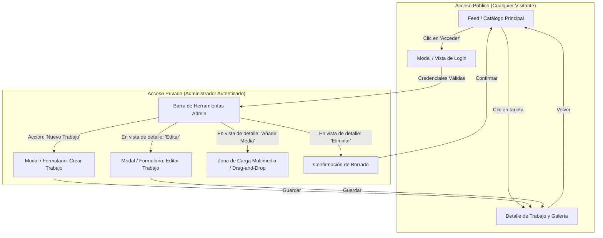

# Mapa de Navegación y Vistas (Views and Navigation)

## 1. Flujo de Navegación del Sistema

El flujo diferencia el acceso público para consulta del flujo privado reservado a la administración y carga de contenido.



---

## 2. Inventario de Vistas y Rutas

| Ruta              | Vista                  | Acceso    | Descripción                                                                     |
| ----------------- | ---------------------- | --------- | ------------------------------------------------------------------------------- |
| `/`               | **Feed Principal**     | Público   | Lista cronológica de trabajos con filtros por estado y orden por fecha.         |
| `/works/:id`      | **Detalle de Trabajo** | Público   | Información completa del trabajo, reproductor de video y galería de fotos.      |
| `/login`          | **Autenticación**      | Público   | Formulario minimalista de acceso para administradores (o modal sobre la vista). |
| `/admin/new`      | **Nuevo Trabajo**      | Protegido | Formulario para ingresar título, estado, fechas y adjuntar archivos iniciales.  |
| `/admin/edit/:id` | **Edición de Trabajo** | Protegido | Modificación de metadatos existentes y gestión individual de fotos/videos.      |

---

## 3. Wireframes Esquemáticos

### 3.1. Vista Principal: Feed / Catálogo (`/`)

```text
+-------------------------------------------------------------------------------+
|  REGISTRO DE TRABAJOS                                  [ + Nuevo ] [ Acceso ] |
|  Bitacora visual de proyectos y actividades                                   |
|-------------------------------------------------------------------------------|
|  [ Todos (14) ]  [ Por Realizar (2) ]  [ En Curso (4) ]  [ Terminados (8) ]   |
|                                                     Ordenar por: [ Mas reciente v]|
|-------------------------------------------------------------------------------|
|  +--------------------+   +--------------------+   +--------------------+     |
|  | [ IMAGEN / VIDEO ] |   | [ IMAGEN / VIDEO ] |   | [ SIN MULTIMEDIA ] |     |
|  |                    |   |                    |   |                    |     |
|  | (Preview 16:9)     |   | (Preview 16:9)     |   | (Espacio reservado)|     |
|  |--------------------|   |--------------------|   |--------------------|     |
|  | [ EN CURSO ]       |   | [ TERMINADO ]      |   | [ POR REALIZAR ]   |     |
|  | Fabricacion Porton |   | Mesa de Roble      |   | Mantenimiento Bomba|     |
|  | 10 Oct 2026        |   | 28 Sep 2026        |   | 15 Oct 2026        |     |
|  | 4 fotos - 1 video  |   | 8 fotos            |   | 0 archivos         |     |
|  +--------------------+   +--------------------+   +--------------------+     |
|                                                                               |
|  +--------------------+   +--------------------+   +--------------------+     |
|  | [ IMAGEN / VIDEO ] |   | [ IMAGEN / VIDEO ] |   | [ IMAGEN / VIDEO ] |     |
|  | ...                |   | ...                |   | ...                |     |
+-------------------------------------------------------------------------------+

```

---

### 3.2. Vista de Detalle de Trabajo (`/works/:id`)

```text
+-------------------------------------------------------------------------------+
|  <- Volver a trabajos                                  [ Editar ] [ Eliminar ]|
|-------------------------------------------------------------------------------|
|                                                                               |
|  [ EN CURSO ]                                                                 |
|  Fabricacion de Porton Corredizo en Acero                                     |
|  Fecha de referencia: 10 de Octubre de 2026 | Inicio: 05 Oct 2026             |
|                                                                               |
|  Descripcion:                                                                 |
|  Estructura en tubo estructural 80x40mm con refuerzos interiores en angulo.   |
|  Fase actual: Preparacion de marco para colocacion de ruedas y riel guia.     |
|                                                                               |
|-------------------------------------------------------------------------------|
|  EVIDENCIA MULTIMEDIA (5 archivos)                       [ + Subir Archivos ] |
|                                                                               |
|  +----------------------------------+  +----------------------------------+   |
|  |  VIDEO: Prueba de Rodamiento     |  |  FOTO: Detalle de Soldadura      |   |
|  |  [ > Reproducir  0:24 / HD ]     |  |  [ Imagen WebP ]                 |   |
|  |                                  |  |                                  |   |
|  +----------------------------------+  +----------------------------------+   |
|  +-----------------+  +-----------------+  +-----------------+                |
|  | FOTO: Escuadra  |  | FOTO: Cortes    |  | FOTO: Base      |                |
|  |                 |  |                 |  |                 |                |
|  +-----------------+  +-----------------+  +-----------------+                |
|                                                                               |
+-------------------------------------------------------------------------------+

```

---

### 3.3. Modal / Vista de Autenticación (`/login`)

```text
+-------------------------------------------------------+
|                                                       |
|                     INICIAR SESION                    |
|          Acceso administrativo a la plataforma        |
|                                                       |
|  Identificador (Correo o Usuario)                     |
|  [ admin@empresa.com                                ] |
|                                                       |
|  Contrasena                                           |
|  [ ******************                               ] |
|                                                       |
|  [       Entrar al Panel       ]                      |
|                                                       |
|  [ Cancelar ]                                         |
+-------------------------------------------------------+

```

---

### 3.4. Modal / Formulario de Creación y Edición (`/admin/new` o `/admin/edit/:id`)

```text
+-------------------------------------------------------------------------------+
|  Nuevo Registro de Trabajo                                            [ X ]   |
|-------------------------------------------------------------------------------|
|  Titulo del Trabajo *                                                         |
|  [ Ej: Instalacion Electrica Tablero Principal                             ]  |
|                                                                               |
|  Estado *                   Fecha de Referencia *                             |
|  [ En Curso           v ]   [ 10 / 10 / 2026    ]                             |
|                                                                               |
|  Fecha de Inicio (Opcional) Fecha de Culminacion (Opcional)                   |
|  [ 08 / 10 / 2026       ]   [ -- / -- / ----    ]                             |
|                                                                               |
|  Descripcion / Notas                                                          |
|  [ Balance de cargas realizado. Pendiente fijacion de canaletas.            ] |
|  [                                                                          ] |
|                                                                               |
|  Adjuntar Fotos o Videos                                                      |
|  + - - - - - - - - - - - - - - - - - - - - - - - - - - - - - - - - - - - - +  |
|  |           Arrastra archivos aqui o haz clic para examinar               |  |
|  |           Formatos: JPG, PNG, WebP (max 10MB) | MP4, WebM (max 150MB)   |  |
|  + - - - - - - - - - - - - - - - - - - - - - - - - - - - - - - - - - - - - +  |
|  Archivos seleccionados:                                                      |
|  - foto1.webp (2.1 MB) ........................................ [ Eliminar ]  |
|  - video_avance.mp4 (34.0 MB) ................................. [ Eliminar ]  |
|                                                                               |
|                                            [ Cancelar ]  [ Guardar Trabajo ]  |
+-------------------------------------------------------------------------------+
```
