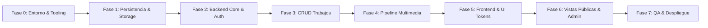

# Plan de Implementación por Fases (Implementation Roadmap)

## 1. Información General del Documento

- **Proyecto:** Bitácora de Trabajos (Plataforma visual y cronológica de proyectos)
- **Ruta del Documento:** `docs/04-implementation-plan/implementation-plan.md`
- **Versión:** 1.0.0
- **Estado:** Propuesto / Línea Base
- **Objetivo:** Establecer la hoja de ruta técnica, secuencial y modular para la construcción, prueba y despliegue del sistema, garantizando la trazabilidad con los requisitos analizados (`01-analysis`), el diseño de arquitectura y datos (`02-system-design`) y el sistema visual minimalista (`03-ui-ux-design`).

---

## 2. Estrategia Global de Ejecución

El plan de trabajo adopta un enfoque iterativo e incremental organizado en **7 fases de desarrollo técnico**, precedidas por una etapa de preparación y culminando con el despliegue a producción:



### Principios Rectores de la Implementación

1. **Vertical Slice & Fundaciones Primero:** La capa de persistencia e integridad de datos se valida antes de construir las interfaces de usuario.
2. **Desacoplamiento Estricto de Medios:** El pipeline de subida multimedia utiliza adaptadores intercambiables (almacenamiento local para desarrollo y Cloudflare R2 / AWS S3 para producción).
3. **Consistencia Transaccional:** Se asegura el borrado físico de archivos en conjunto con la eliminación en cascada en la base de datos (`CASCADE`).
4. **Diseño "El contenido es la interfaz":** La interfaz se construye desde el primer momento siguiendo el sistema de tokens monocromáticos y la ausencia de sobrecarga visual.

---

## 3. Matriz Resumen de Fases y Dependencias

| Fase       | Denominación                                  | Entregable Clave                                                        | Dependencias |
| :--------- | :-------------------------------------------- | :---------------------------------------------------------------------- | :----------- |
| **Fase 0** | Entorno, Tooling y Configuración Base         | Repositorio estructurado, linter, TypeScript y Docker local.            | Ninguna      |
| **Fase 1** | Modelo de Datos y Capa de Almacenamiento      | Migraciones DDL SQL ejecutadas y adaptador de Storage funcional.        | Fase 0       |
| **Fase 2** | Backend Core, Seguridad y Autenticación       | Endpoints `/auth/*` y middleware de sesiones con cookies seguras.       | Fase 1       |
| **Fase 3** | Módulo de Trabajos (CRUD & Dominio)           | Endpoints `/works/*` con filtros cronológicos y validaciones de fechas. | Fase 2       |
| **Fase 4** | Módulo Multimedia y Streaming de Archivos     | Endpoints `/media/*`, validación de _magic bytes_ y purga física.       | Fase 3       |
| **Fase 5** | Frontend Core, Tokens y Sistema de Diseño     | Shell visual minimalista, tema tipográfico y componentes atómicos.      | Fase 0       |
| **Fase 6** | Vistas Públicas, Catálogo e Interacción Admin | Feed cronológico, visor de medios y modales administrativos.            | Fases 4, 5   |
| **Fase 7** | QA, Rendimiento, Auditoría y Despliegue       | Entorno productivo en vivo, SSL/TLS y métricas Core Web Vitals.         | Fase 6       |

---

## 4. Desglose Detallado por Fases

### Fase 0: Preparación del Entorno, Tooling y Configuración Inicial

#### 0.1. Objetivos

Configurar la base técnica del proyecto, estándares de código, variables de entorno y soporte para desarrollo local consistente.

#### 0.2. Tareas Técnicas

- [ ] Inicializar el repositorio Git con la estructura de carpetas estándar (`docs/`, `src/client/`, `src/server/` o arquitectura monolítica modular elegida en `04-tech-stack.md`).
- [ ] Configurar `.gitignore` para omitir dependencias (`node_modules/`), compilados (`dist/`, `build/`), variables de entorno (`.env`, `.env.local`) y archivos de sistema operativo.
- [ ] Configurar TypeScript (`tsconfig.json`) con modo estricto (`"strict": true`).
- [ ] Configurar herramientas de formateo y calidad de código: ESLint y Prettier con reglas sin punto y coma innecesario o estilos estandarizados.
- [ ] Crear plantilla de configuración `.env.example` con las claves requeridas:
  - `DATABASE_URL`
  - `SESSION_SECRET`
  - `STORAGE_DRIVER` (`local` | `s3`)
  - `STORAGE_BUCKET`, `STORAGE_ENDPOINT`, `STORAGE_ACCESS_KEY`, `STORAGE_SECRET_KEY`
  - `MAX_IMAGE_SIZE_BYTES=10485760` (10 MB)
  - `MAX_VIDEO_SIZE_BYTES=157286400` (150 MB)
- [ ] Configurar contenedor de desarrollo `docker-compose.yml` para base de datos relacional local (PostgreSQL) y emulador de almacenamiento S3 local (MinIO, opcional si se usa storage local).

#### 0.3. Criterios de Aceptación (DoD)

- Repositorio clona, ejecuta `npm install` (o `pnpm install`) y corre scripts de verificación (`lint`, `type-check`) sin errores.
- Contenedor de base de datos local levanta y acepta conexiones exitosas.

---

### Fase 1: Capa de Persistencia y Adaptador de Almacenamiento

#### 1.1. Objetivos

Implementar la base de datos relacional respetando 3FN (`docs/02-system-design/03-data-model.md`) y abstraer el almacenamiento de archivos (`RNF-STOR-02`).

#### 1.2. Tareas Técnicas

- [ ] Configurar herramienta de migraciones y acceso a datos (ej. Drizzle ORM o Prisma o migraciones SQL nativas).
- [ ] Implementar la migración DDL SQL con las tablas:
  - `users`: ID UUID, correo único, hash de clave, nombre completo y marcas temporales.
  - `work_items`: ID UUID, referencia foránea a `users`, campos de título, descripción, estado, fecha de referencia y fechas de inicio/fin.
  - `media_assets`: ID UUID, referencia foránea a `work_items` con regla `ON DELETE CASCADE`.
- [ ] Implementar y verificar a nivel de base de datos las restricciones de integridad:
  - Constraint temporal:
    $$ \text{end\_date IS NULL} \lor \text{start\_date IS NULL} \lor (\text{end\_date} \ge \text{start\_date}) $$
  - Constraint de estados: `status IN ('pending', 'in_progress', 'completed')`.
  - Constraint de multimedia: `media_type IN ('image', 'video')`.
- [ ] Crear los índices de alto rendimiento:
  - `idx_work_items_ref_date` (`reference_date DESC`).
  - `idx_work_items_status` (`status`).
  - `idx_work_items_status_date` (`status, reference_date DESC`).
  - `idx_media_assets_work_order` (`work_item_id, sort_order ASC`).
- [ ] Crear la interfaz y el adaptador de almacenamiento de medios (`StorageDriver`):
  - `LocalDiskStorageDriver`: Almacenamiento local en disco aislado (`/uploads`) para pruebas y entornos de desarrollo.
  - `S3StorageDriver`: Conexión mediante SDK compatible con S3 (Cloudflare R2 o AWS S3) para producción.
  - Métodos: `putObject(stream, key, mimeType)`, `deleteObject(key)`, `getUrl(key)`.
- [ ] Desarrollar script de seeding `db:seed` para generar un usuario administrador inicial con contraseña cifrada y 3 trabajos de prueba con diferentes estados.

#### 1.3. Criterios de Aceptación (DoD)

- Ejecución completa de migraciones y reversiones (_up_ y _down_) sin inconsistencias.
- Las pruebas de inserción manual de registros que violen los constraints (ej. $\text{end\_date} < \text{start\_date}$) fallan a nivel de motor de datos.
- Subida y borrado exitoso de un archivo binario mediante la interfaz unificada del `StorageDriver`.

---

### Fase 2: Backend Core, Seguridad y Autenticación

#### 2.1. Objetivos

Construir la capa de servidor HTTP, middlewares de seguridad, validación de sesiones con cookies seguras y endpoints de autenticación (`/auth`).

#### 2.2. Tareas Técnicas

- [ ] Configurar servidor HTTP y pipeline de middlewares:
  - Manejo de CORS configurado de forma estricta para el origen de la aplicación.
  - Parser de JSON y cookies.
  - Manejador centralizado de errores para respuestas uniformes con la estructura:
    ```json
    {
      "error": {
        "code": "BAD_REQUEST",
        "message": "Descripción clara del fallo",
        "details": []
      }
    }
    ```
- [ ] Implementar utilidad criptográfica para contraseñas utilizando `Argon2id` o `bcrypt` (factor de coste $\ge 12$).
- [ ] Implementar middleware de sesión basado en cookies seguras (`RNF-SEC-02`):
  - Flags obligatorias: `HttpOnly`, `Secure`, `SameSite=Lax`, `Path=/`.
  - Cifrado o firma de la cookie con `SESSION_SECRET`.
- [ ] Implementar los endpoints del módulo de autenticación:
  - `POST /api/v1/auth/login`: Validación de identificador/contraseña con mensaje de error genérico en caso de falla (`RF-AUTH-01`).
  - `POST /api/v1/auth/logout`: Invalidación de sesión y limpieza de la cookie (`RF-AUTH-02`).
  - `GET /api/v1/auth/me`: Retorna el estado de autenticación y datos del usuario actual.
- [ ] Crear el middleware `requireAuth` para denegar peticiones no autenticadas con código `401 Unauthorized`.

#### 2.3. Criterios de Aceptación (DoD)

- Petición con credenciales erróneas devuelve `401` con mensaje genérico de error.
- Petición exitosa a `/auth/login` emite la cabecera `Set-Cookie` con los atributos de seguridad correctos.
- Endpoint protegido con `requireAuth` rechaza peticiones sin cookie válida y permite el paso con sesión activa.

---

### Fase 3: Módulo de Trabajos (CRUD y Reglas de Negocio)

#### 3.1. Objetivos

Implementar la lógica de negocio completa para la gestión de proyectos/trabajos (`work_items`), cumpliendo las reglas `RN-01`, `RN-02`, `RN-06` y los endpoints de `api-specification.md`.

#### 3.2. Tareas Técnicas

- [ ] Implementar validadores de esquemas de entrada (usando Zod o biblioteca similar):
  - Validación de campos requeridos (`title`, `status`, `reference_date`).
  - Validación de coherencia temporal en capa de aplicación:
    $$ \text{end\_date} \ge \text{start\_date} $$
- [ ] Endpoint de lectura pública: `GET /api/v1/works`:
  - Soporte de filtro por estado: `pending`, `in_progress`, `completed`.
  - Soporte de ordenación: `order=desc` (predeterminado) y `order=asc` sobre `reference_date`.
  - Paginación con parámetros `limit` y `offset`.
  - Inclusión de vista previa multimedia (`media_preview`) y recuento de fotos/videos (`media_count`).
- [ ] Endpoint de detalle público: `GET /api/v1/works/:id`:
  - Retorna información completa del trabajo junto con la lista ordenada de recursos multimedia (`sort_order ASC`).
  - Manejo de error `404 Not Found` en caso de ID inexistente.
- [ ] Endpoint protegido: `POST /api/v1/works` (`RF-WORK-01`):
  - Inserción vinculada al `user_id` de la sesión autenticada.
  - Asignación de fecha actual si no se provee `reference_date`.
- [ ] Endpoint protegido: `PATCH /api/v1/works/:id` (`RF-WORK-02`, `RF-WORK-04`):
  - Actualización parcial de campos y transiciones de estado libres.
  - Actualización automática de `updated_at`.
- [ ] Endpoint protegido: `DELETE /api/v1/works/:id` (`RF-WORK-03`):
  - Validación de existencia previa y permisos.

#### 3.3. Criterios de Aceptación (DoD)

- Consulta `GET /works` ejecuta consultas con tiempo de respuesta inferior a 250 ms (`RNF-PERF-03`).
- Intentos de crear o actualizar un trabajo con fechas incongruentes son rechazados con `400 Bad Request`.
- Pruebas automatizadas de integración cubren los casos de éxito y de error de los 5 endpoints.

---

### Fase 4: Módulo Multimedia, Streaming y Purga Física

#### 4.1. Objetivos

Desarrollar el procesamiento y almacenamiento de imágenes y videos pesados, validación de cabeceras binarias y garantía de consistencia física en el borrado (`RN-04`).

#### 4.2. Tareas Técnicas

- [ ] Implementar middleware de recepción `multipart/form-data` con streaming directo al almacenamiento para evitar saturar la memoria RAM del servidor.
- [ ] Crear validador de seguridad de binarios (_Magic Bytes_) (`RNF-SEC-03`):
  - Inspección de cabeceras binarias para asegurar que los archivos correspondan efectivamente a imágenes (`image/jpeg`, `image/png`, `image/webp`) o videos (`video/mp4`, `video/webm`).
  - Rechazo inmediato de extensiones ejecutables camufladas.
- [ ] Implementar verificadores de cuotas y límites (`RNF-STOR-01`, `RN-03`):
  - Máximo 10 MB por foto.
  - Máximo 150 MB por video.
  - Máximo 20 imágenes y 4 videos por cada trabajo.
- [ ] Endpoint protegido: `POST /api/v1/works/:id/media` (`RF-MEDIA-01`, `RF-MEDIA-02`):
  - Recepción de archivos, guardado mediante `StorageDriver`, cálculo de metadatos (`mime_type`, `file_size_bytes`, `media_type`).
  - Inserción de registros en la tabla `media_assets`.
- [ ] Endpoint protegido: `DELETE /api/v1/media/:id` (`RF-MEDIA-04`):
  - Búsqueda del recurso, eliminación en base de datos y borrado físico inmediato en el storage.
- [ ] Implementar borrado transaccional completo en `DELETE /api/v1/works/:id`:
  - Transacción atómica que recupera todas las claves de archivos en `media_assets`, elimina el trabajo (desencadenando `CASCADE` en BD) y purga todos los binarios físicos asociados en el storage (`RN-04`).

#### 4.3. Criterios de Aceptación (DoD)

- Subida rechazada con `413 Payload Too Large` si un archivo excede los límites de 10 MB (fotos) o 150 MB (videos).
- Un archivo renombrado fraudulentamente a `.png` con contenido ejecutable es detectado y rechazado por el análisis de magic bytes.
- Al eliminar un trabajo con archivos multimedia adjuntos, se verifica que no quede ningún archivo huérfano en el almacenamiento.

---

### Fase 5: Frontend Core, Tokens y Sistema de Diseño Minimalista

#### 5.1. Objetivos

Crear la arquitectura de interfaz en el cliente basada en la guía de estilos (`docs/03-ui-ux-design/01-minimalist-style-guide.md`) con Tailwind CSS y componentes reutilizables.

#### 5.2. Tareas Técnicas

- [ ] Configurar el sistema de estilos y variables de Tailwind CSS integrando los design tokens:
  - Fondo general: `--color-bg-canvas: #FAFAFA`
  - Superficie: `--color-bg-surface: #FFFFFF`
  - Borde sutil: `--color-border-subtle: #E5E7EB`
  - Texto principal: `--color-text-primary: #111827`
  - Texto secundario: `--color-text-secondary: #6B7280`
  - Texto atenuado: `--color-text-muted: #9CA3AF`
- [ ] Configurar la escala tipográfica con la pila del sistema:
  - `-apple-system, BlinkMacSystemFont, "Inter", "Segoe UI", Roboto, sans-serif`
  - Display/H1 (`32px`), H2 (`24px`), H3 (`18px`), Body (`15px`), Caption (`13px`).
- [ ] Construir la biblioteca de componentes atómicos:
  - `StatusBadge`: Variante pildorada para los tres estados:
    - _Por Realizar_ (`#F3F4F6` con texto `#374151`)
    - _En Curso_ (`#EFF6FF` con texto `#1D4ED8`)
    - _Terminado_ (`#ECFDF5` con texto `#047857`)
  - `Button`: Variantes Primario (`#111827`), Secundario/Outline (`#E5E7EB`) y Destructivo (`#DC2626`).
  - `Input` / `Textarea` / `Select`: Diseños sobrios con bordes finos de 1px y foco de alto contraste.
  - `Modal` / `Dialog`: Contenedor centrado con fondo atenuado y ancho máximo de 512px (`max-w-lg`).
- [ ] Configurar cliente de API en el frontend con soporte para cookies de sesión y manejo unificado de errores y estados de carga.

#### 5.3. Criterios de Aceptación (DoD)

- La paleta monocromática y los badges de estado coinciden con exactitud con las especificaciones del style guide.
- La navegación responde de forma fluida a breakpoints de teléfono móvil ($< 640\text{ px}$), tablet ($640\text{ px} - 1024\text{ px}$) y escritorio ($> 1024\text{ px}$) sin desbordamiento horizontal (`RNF-USAB-02`).

---

### Fase 6: Vistas Públicas, Catálogo e Interacción Administrativa

#### 6.1. Objetivos

Implementar los flujos de navegación, vistas públicas y privadas especificadas en `docs/03-ui-ux-design/02-views-and-navigation.md`.

#### 6.2. Tareas Técnicas

- [ ] **Vista Feed Principal (`/`) (`RF-FEED-01`, `RF-FEED-02`):**
  - Encabezado con título del catálogo y botones de acceso según estado de sesión (_Acceder_ o _+ Nuevo Trabajo_ y _Cerrar Sesión_).
  - Barra de filtros por pestañas (_Todos_, _Por Realizar_, _En Curso_, _Terminados_) con recuentos numéricos dinámicos.
  - Selector de ordenación cronológica (_Más reciente_ / _Más antiguo_).
  - Rejilla adaptativa de tarjetas de trabajo con relación de aspecto fija (16:9), badge de estado, fecha formateada y contadores de recursos.
  - Implementación de carga diferida nativa (_lazy loading_) para las imágenes de la cuadrícula (`RNF-PERF-01`).
- [ ] **Vista Detalle de Trabajo (`/works/:id`) (`RF-FEED-03`):**
  - Botón de retorno al feed (`<- Volver a trabajos`).
  - Cabecera con título, badge de estado, fechas de referencia, inicio y entrega.
  - Cuerpo de texto descriptivo.
  - Rejilla de galería multimedia adaptativa (2 columnas en móvil, 3 en escritorio).
  - Reproductor de video nativo con soporte de streaming progresivo y sin autoplay con sonido.
  - Visor modal o expandido de imágenes en alta definición.
- [ ] **Modal de Autenticación (`/login`):**
  - Formulario minimalista con campos de identificador y contraseña.
  - Feedback visual de credenciales incorrectas.
- [ ] **Modales y Formularios Administrativos (`/admin/new`, `/admin/edit/:id`):**
  - Formulario con campos de título, estado, fechas y descripción.
  - Zona de carga multimedia (_Drag-and-Drop_) con previsualización inmediata de archivos seleccionados (`RNF-USAB-03`).
  - Barra de progreso para subidas de archivos pesados.
  - Botón de eliminación individual de fotos/videos en modo edición.
- [ ] **Modal de Confirmación Destructiva:**
  - Diálogo de confirmación explícita antes de eliminar un trabajo o recurso multimedia.

#### 6.3. Criterios de Aceptación (DoD)

- Un visitante no autenticado puede consultar el feed, aplicar filtros por estado, alternar el orden y ver el detalle con fotos y videos sin ver controles de edición.
- Un administrador autenticado puede crear un trabajo, subir videos e imágenes, editar metadatos y eliminar registros.
- La interfaz ofrece retroalimentación visual clara durante subidas de archivos pesados.

---

### Fase 7: Pruebas, Aseguramiento de Calidad, Rendimiento y Despliegue

#### 7.1. Objetivos

Validar el cumplimiento estricto de todos los requisitos no funcionales, realizar pruebas integrales y desplegar la aplicación a producción.

#### 7.2. Tareas Técnicas

- [x] **Pruebas de Seguridad:**
  - Verificar que las cookies tengan obligatoriamente `HttpOnly`, `Secure` y `SameSite=Lax`.
  - Probar intentos de inyección y manipulación de parámetros foráneos en mutaciones.
  - Verificar bloqueo de subida de scripts mediante magic bytes.
- [x] **Optimización de Rendimiento y Core Web Vitals:**
  - Auditar con Google Lighthouse en vista de catálogo público.
  - Verificar que el LCP (_Largest Contentful Paint_) en conexiones de banda ancha estándar sea menor a 2.0 segundos:
    $$ \text{LCP} \le 2.0\text{ s} $$
  - Verificar que el tiempo de respuesta promedio de `GET /api/v1/works` sea menor a 250 ms:
    $$ t_{\text{resp}} < 250\text{ ms} $$
- [x] **Configuración de CI/CD (GitHub Actions):**
  - Workflow automatizado que ejecute chequeos de tipos (`type-check`), linter y pruebas automatizadas en cada _Pull Request_.
  - Pipeline de despliegue automático hacia el hosting de producción (Vercel, Render o Cloudflare Pages).
- [x] **Aprovisionamiento de Infraestructura de Producción:**
  - Configuración de base de datos PostgreSQL de producción (Neon, Supabase o RDS).
  - Ejecución de migraciones productivas.
  - Creación de bucket de almacenamiento de objetos (Cloudflare R2 o AWS S3) con políticas de acceso y CDN configurado.
  - Creación controlada del usuario administrador inicial en la base de datos de producción.
- [x] **Configuración de Dominio y Certificados:**
  - Configuración de DNS, forzado de HTTPS estricto con TLS 1.2 o TLS 1.3 (`RNF-SEC-04`).
- [x] **Smoke Testing en Producción:**
  - Verificación en vivo de login, creación de trabajo con fotos y videos, streaming de video y flujo de borrado con purga física.

#### 7.3. Criterios de Aceptación (DoD)

- Certificado SSL/TLS activo y calificación de rendimiento en Lighthouse $\ge 90$ en escritorio y móvil.
- La aplicación responde en producción sin errores en consola y todas las rutas públicas y protegidas operan según los contratos de API y diseño.

---

## 5. Matriz de Trazabilidad de Requisitos

A continuación se muestra el mapeo entre los requisitos establecidos y las fases donde se materializan:

| Código Requisito  | Descripción                                                     | Fase de Implementación             |
| :---------------- | :-------------------------------------------------------------- | :--------------------------------- |
| `RF-AUTH-01`      | Inicio de Sesión Administrativo                                 | Fase 2 (API) + Fase 6 (UI)         |
| `RF-AUTH-02`      | Cierre de Sesión                                                | Fase 2 (API) + Fase 6 (UI)         |
| `RF-AUTH-03`      | Protección de Rutas y Operaciones                               | Fase 2 (Middleware)                |
| `RF-WORK-01`      | Registro de Nuevo Trabajo                                       | Fase 3 (API) + Fase 6 (UI)         |
| `RF-WORK-02`      | Edición de Información del Trabajo                              | Fase 3 (API) + Fase 6 (UI)         |
| `RF-WORK-03`      | Eliminación de Trabajo con Borrado en Cascada                   | Fase 3, Fase 4 (API) + Fase 6 (UI) |
| `RF-WORK-04`      | Transición entre los 3 Estados                                  | Fase 3 (API) + Fase 6 (UI)         |
| `RF-MEDIA-01`     | Carga de Fotografías (JPG, PNG, WebP)                           | Fase 4 (API) + Fase 6 (UI)         |
| `RF-MEDIA-02`     | Carga y Streaming de Videos (MP4, WebM)                         | Fase 4 (API) + Fase 6 (UI)         |
| `RF-MEDIA-03`     | Visualización y Reproducción Multimedia                         | Fase 6 (UI)                        |
| `RF-MEDIA-04`     | Eliminación Individual de Recursos Multimedia                   | Fase 4 (API) + Fase 6 (UI)         |
| `RF-FEED-01`      | Listado Cronológico de Trabajos                                 | Fase 3 (API) + Fase 6 (UI)         |
| `RF-FEED-02`      | Filtrado por Estado                                             | Fase 3 (API) + Fase 6 (UI)         |
| `RF-FEED-03`      | Vista Detallada del Trabajo                                     | Fase 3 (API) + Fase 6 (UI)         |
| `RNF-USAB-01`     | Estética Minimalista y Reducción Cognitiva                      | Fase 5                             |
| `RNF-USAB-02`     | Diseño Web Adaptativo (Responsive)                              | Fase 5, Fase 6                     |
| `RNF-USAB-03`     | Retroalimentación de Operaciones Asíncronas                     | Fase 6                             |
| `RNF-PERF-01`     | Optimización Multimedia y Lazy Loading ($LCP \le 2.0\text{ s}$) | Fase 6, Fase 7                     |
| `RNF-PERF-02`     | Streaming Progresivo de Video                                   | Fase 4, Fase 6                     |
| `RNF-PERF-03`     | Tiempo de Respuesta de API $< 250\text{ ms}$                    | Fase 3, Fase 7                     |
| `RNF-SEC-01`      | Hash de Contraseñas (Argon2id / bcrypt)                         | Fase 2                             |
| `RNF-SEC-02`      | Cookies de Sesión Seguras (HttpOnly, SameSite)                  | Fase 2                             |
| `RNF-SEC-03`      | Validación de Magic Bytes en Archivos                           | Fase 4                             |
| `RNF-SEC-04`      | Cifrado en Tránsito HTTPS                                       | Fase 7                             |
| `RNF-STOR-01`     | Límites de Tamaño (10 MB fotos, 150 MB videos)                  | Fase 4                             |
| `RNF-STOR-02`     | Abstracción de Capa de Almacenamiento                           | Fase 1, Fase 4                     |
| `RN-01` a `RN-07` | Reglas de Negocio de Fechas, Estados y Cascada                  | Fases 1, 3, 4                      |

---

## 6. Gestión de Riesgos y Mitigaciones

| Riesgo Identificado                                            | Impacto | Probabilidad | Estrategia de Mitigación                                                                                                                                                       |
| :------------------------------------------------------------- | :------ | :----------- | :----------------------------------------------------------------------------------------------------------------------------------------------------------------------------- |
| **Saturación de memoria por videos grandes (hasta 150 MB)**    | Alto    | Media        | Procesar la subida vía streaming directo al almacenamiento de objetos o usar URLs prefirmadas (_presigned URLs_), evitando almacenar buffers completos en RAM.                 |
| **Archivos huérfanos en disco al fallar borrados**             | Medio   | Media        | Implementar transacción atómica: confirmar la eliminación en base de datos antes de disparar la purga física y registrar logs de fallos de borrado en storage para reintentos. |
| **Tiempos lentos de carga en el feed por volumen de imágenes** | Alto    | Baja         | Generación o servicio de miniaturas optimizadas en WebP, carga diferida (`loading="lazy"`) y paginación con límite de 20 registros por petición.                               |
| **Subida de archivos maliciosos renombrados**                  | Crítico | Baja         | Inspección obligatoria de _magic bytes_ en el servidor antes de persistir cualquier archivo, descartando la confianza exclusiva en la extensión de archivo.                    |

---

## 7. Estrategia de Ramas y Control de Versiones

Para asegurar la estabilidad del proyecto durante el desarrollo iterativo:

- `main`: Rama de código en producción. Siempre desplegable y estable.
- `develop`: Rama de integración donde convergen las fases terminadas.
- Ramas por fase/tarea: Formato `feat/fase-[numero]-[nombre]` (por ejemplo: `feat/fase-1-data-layer`, `feat/fase-4-media-upload`).
- Cada fase debe superar revisión de código, verificación de tipos y tests unitarios antes de hacer merge a `develop`.
